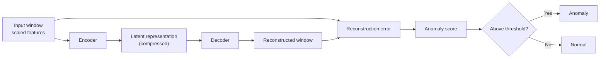
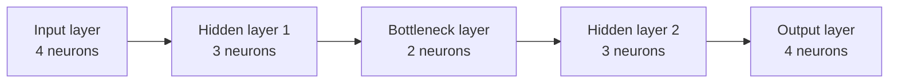

# Machine/deep-learning models for anomaly detection

This document describes candidate machine-learning models to compare with the statistical baselines in [03_baselines.md](./03_baselines.md).

---

## 1. Isolation Forest - ML algorithm

Isolation Forest is an unsupervised anomaly detection method for tabular data. It identifies observations that are easier to isolate from the rest of the data. It is a candidate for detecting unusual combinations of Nginx features
that independent univariate baselines may not identify.

### Principle

The method builds an ensemble of isolation trees. Each tree repeatedly **selects a feature and a split value** (between the min and max of that feature) at random, partitioning the observations until a window is isolated or a stopping condition is reached. An observation isolated in fewer splits than typical observations is considered more anomalous.

The anomaly score is based on the **average path length across the trees**: shorter average paths indicate greater anomaly. Implementations may expose scores with different signs or conventions. For comparisons in this project, the reported `anomaly_score` must consistently increase with anomaly.

### Proposed application to this project

- Treat each timestamped 5-minute window as one observation.
- Use numeric features from the feature table in notebook 03; evaluate feature subsets separately where useful, rather than assuming that including every feature improves detection.
- Exclude `timestamp` from the model input. Preserve it to align each score and decision with its original window.
- Fit the model on the chronological reference period only. Score the later evaluation period without refitting on it.
- Return one anomaly score per evaluation window and a binary decision derived from a threshold calibrated using the reference period only.

### Parameters to evaluate (from sklearn.sklearn.ensemble.IsolationForest)

The experiment should record the selected values and rationale for:

- **n_estimators**: Number of trees (more = better, slower)
- **contamination**:(helps calibrate threshold) Expected % of anomalies -- % unkonwn with unlabled data 
- **max_samples**: # of samples used per tree (default = 'auto')
- **Subsample size:** controls the number of observations considered by each
- **Random seed:** should be fixed for reproducibility

### Strengths and limitations

**Potential strengths**

- Uses several features jointly and can detect multivariate outliers.
- Does not require anomaly labels during fitting.
- Tree-based splits generally do not require feature standardization solely to
  put numeric variables on a common scale.

**Limitations**

- Does not use temporal order, so a window's context and recurring daily
  patterns are not modeled explicitly.
- Results depend on the selected features, hyperparameters, random seed, and
  threshold.
- Correlated, redundant, or differently distributed features can affect which
  observations are isolated.

### Evaluation protocol

Use the chronological reference/evaluation split described in [03_baselines.md](./03_baselines.md).Compare Isolation Forest with B1-B4 using the same windows and relevant feature sets. Report the existing alert-volume, alert-sequence, duration, temporal concentration, and signal-consistency measures, as well as the chosen
parameters.

Evaluate sensitivity with controlled synthetic perturbations, such as isolated
spikes or drops, gradual drift, and coordinated changes in related features.
Record detection of the perturbed windows and alerts outside them. Preserve
logical constraints between related features when constructing perturbations.

---

## 2. Autoencoder - deep learning (nn)

An autoencoder is a neural network trained to reconstruct its input. It learns a
compact representation of the patterns present in the reference data (~ normal data). If it is
trained mainly on normal windows, an unusual/abnormal window may be reconstructed less
accurately and receive a higher reconstruction error. This makes it a candidate
for detecting multivariate anomalies in the feature temporal table.

### Principle

The **encoder** compresses the input features into a smaller latent
representation; the **decoder** uses that representation to reconstruct the
input. Training minimizes the difference between each input and its
reconstruction.

Here is a general example of a fully connected autoencoder. The encoder
reduces the number of neurons through its hidden layers to a bottleneck; the
decoder expands it again. The numbers are illustrative and do not represent
the number of features in this project.

Each layer contains the indicated number of neurons. The output has the same
number of neurons as the input so it can reconstruct it. The actual layer
sizes depend on the data and should be selected using the reference data and
validation period.

For a window with input vector $x_t$ and reconstruction $\hat{x}_t$, a simple
score is the mean squared reconstruction error:

$$
S_t = \frac{1}{p}\sum_{j=1}^{p}(x_{t,j}-\hat{x}_{t,j})^2
$$

where $p$ is the number of input features. This score increases with
reconstruction error, and therefore with anomaly. Mean absolute error can also
be evaluated if it is more robust to large reconstruction differences.

### application to this project

- Treat each timestamped 5-minute window as one observation, using numeric
  features from the feature table in notebook 03.
- Exclude `timestamp` from the model input and preserve it to align each score
  and decision with its original window.
- Scale features because counts, rates, and shares have different ranges. Fit
  the scaler on the training portion of the reference period only, then use
  that same scaler for validation and evaluation.
- Split the chronological reference period into training and validation
  portions. Train the network on the training portion and use the validation
  portion to select settings and calibrate the anomaly threshold. Do not use
  evaluation windows for either step.
- Return one reconstruction-error `anomaly_score` per evaluation window and a
  binary `is_anomaly` decision using the fixed threshold.

This basic setup analyzes each window independently. It does not learn
sequences or recurring temporal patterns unless temporal features or sequences
are explicitly added as inputs.

### Parameters to evaluate

Record the selected values and rationale for:

- **Architecture:** number of encoder/decoder layers and units.
- **Latent dimension:** size of the compressed representation; too large a
  representation can allow the model to reconstruct unusual inputs well.
- **Loss function:** mean squared error (MSE) or mean absolute error (MAE).
- **Learning rate and optimizer (ex.adam):** control how the network updates its weights.
- **Batch size and epochs:** amount of data per update and number of training
  passes. Use validation loss for stopping or model selection.
- **Random seed:** fix it for reproducibility.
- **Threshold:** calibrate on reconstruction errors from the reference
  validation portion only, and state the calibration rule (for example, a
  chosen percentile).

### Strengths and limitations

**Potential strengths**

- Uses features jointly and can detect unusual combinations that individual
  feature thresholds may miss.
- Does not require anomaly labels during training .
- Can model nonlinear relationships between features.

**Limitations**

- Works best when the training reference is representative of normal data ; otherwise the network may learn to reconstruct anomalous patterns.
- A model with too much capacity may reconstruct anomalies well and fail to
  distinguish them.
- Feature scaling, architecture, random initialization, and threshold
  calibration can strongly affect results.
- Training is more computationally involved than Isolation Forest, and results
  may be less interpretable.
- As described here, it does not explicitly model temporal order or
  seasonality.

### implementation in python
Autoencoders are deep learning models, making **Keras and PyTorch** the industry standards and best choices for building them. While **Keras** offers a **fast and user-friendly API perfect for standard architectures**, **PyTorch provides total flexibility and control** for complex or research-oriented models. In contrast, Scikit-Learn is not designed for deep networks .

---

# References 

1. Isolation Forest (scikit-learn): [documentation](https://scikit-learn.org/stable/modules/generated/sklearn.ensemble.IsolationForest.html)

2. Autoencoder with scikit-learn: scikit-learn does not provide a dedicated `Autoencoder` class. A simple autoencoder can be built using `MLPRegressor` by using the same features as both inputs and targets: [`MLPRegressor` documentation](https://scikit-learn.org/stable/modules/generated/sklearn.neural_network.MLPRegressor.html).

3. General overview of autoencoders: [TensorFlow — Autoencoders](https://www.tensorflow.org/tutorials/generative/autoencoder).

4. Autoencoder with PyTorch: define a custom model with `torch.nn.Module`, use
   `torch.nn.Linear` layers for the encoder and decoder, and train it with a
   reconstruction loss such as `torch.nn.MSELoss`: [PyTorch `torch.nn`
   documentation](https://pytorch.org/docs/stable/nn.html).